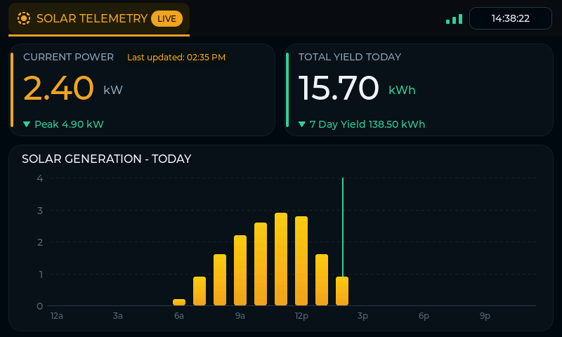

# Solar Ops Dashboard

A wall-mounted solar-telemetry HMI for the **Waveshare ESP32-S3-Touch-LCD-7**
(800×480, 7", RGB + touch), built with PlatformIO / arduino-esp32 / LVGL 8.
The board is a **pure renderer**: an always-on host (the Mac) polls the
Enphase IQ Gateway, accumulates today's production, and pushes
ready-to-render screen state to the board once per second over a LAN TCP
socket. The board never performs a long radio pull — that was the root
cause of the panel's ghosting/tearing (see
[docs/GHOSTING_INVESTIGATION.md](docs/GHOSTING_INVESTIGATION.md) §8).

## Architecture

```
 Enphase IQ Gateway ──60 s HTTPS poll──>  Rust push server (Mac, server/)
                                             │ 15-min buckets + SQLite
                                             │ (today's state survives
                                             │  service restarts)
                                             └──1 s TCP push──────────>  ESP32-S3 + LVGL
                                                 newline-delimited JSON    (thin socket client
                                                 (complete screen state)     + renderer)
```

The push payload is a documented, versioned contract
(`"v":1` — `server/src/contract.rs`): current watts, today's yield,
today's peak, 7-day energy, the 96 15-minute generation buckets, and the
host's `epoch` (the board's **only** clock source: header clock and chart
now-line both derive from it). The board merges nothing — every line is
the complete screen state.

WiFi airtime on the board is a ~1 s connect plus millisecond receives,
which the one-variable ghosting experiments proved clean; the Envoy's
20–55 s TLS fetches were the trigger, and they now happen on the Mac.

Today's buckets are computed from deltas of the Envoy's cumulative
`whToday` counter (bucket-start baseline, live partial, straddle carry
across boundaries gated on sample freshness, gap gate leaves missed
buckets empty), ported from the retired board-side `solar_hist` module
and now living in `server/src/buckets.rs` with a Rust test suite that
mirrors the old Unity case list.



*Rendered by the host simulator (`firmware/hostsim/`) — the same
`dashboard_ui.cpp` the board runs, with a canned mid-afternoon sample.*

## Layout

```
server/             Rust push service (`just run`)
├── src/            main.rs (wiring), config.rs, envoy.rs, buckets.rs,
│                   contract.rs, store.rs (SQLite), push.rs, clock.rs
├── tests/          socket-pusher integration test (fake board client)
├── config.example.toml   template for the gitignored config.toml
└── data/           solar.db — today's buckets (gitignored runtime state)

firmware/            PlatformIO project for the board
├── platformio.ini   board config: 16 MB flash, OPI PSRAM, 921600-baud console
├── src/             application: main.cpp, dashboard_ui.cpp (renderer),
│                   push_client.cpp (socket client — the entire data layer)
├── include/         lv_conf.h + secrets.h (gitignored) + secrets_example.h
├── lib/             vendored: LVGL 8.4, ESP32_Display_Panel, IO expander, CH343
└── hostsim/         macOS SDL2 simulator of dashboard_ui.cpp + snapshot tooling

docs/                NOTES.md — bring-up record, experiments, decisions
demos/               Waveshare official examples clone (reference only, untracked)
```

## Quick start

Host service (macOS):

    brew install just        # task runner
    cargo --version || rustup default stable
    cd server
    cp config.example.toml config.toml    # fill in envoy_host + envoy_token
    cd .. && just run                     # Ctrl-C to stop

`server/config.toml` carries the Envoy host + bearer token — it is
gitignored and never committed. The service creates and maintains
`server/data/solar.db` (today's buckets).

Board firmware:

    cp firmware/include/secrets_example.h firmware/include/secrets.h   # Wi-Fi + server IP
    just fw-flash          # USB-C port (see NOTES.md); monitor: just fw-monitor

`secrets.h` needs only the Wi-Fi credentials and the push server's LAN
address — Envoy credentials no longer live on the board at all.

The board's wall clock comes entirely from the pushed `epoch` (nudged
when drift > 5 s). The 921600-baud serial console keeps the `SNAPSHOT` /
`LVSNAP` frame-dump diagnostics from the ghosting investigation.

## ESP-IDF driver patch (ghosting fix)

The RGB panel driver (`esp_lcd`) ships precompiled with a bounce-buffer
desync bug ([espressif/esp-idf#19070](https://github.com/espressif/esp-idf/issues/19070))
that causes the persistent screen ghost. This repo carries the one-line
fix as a patch and documents how to rebuild + install the patched
`libesp_lcd.a`: see [patches/README.md](patches/README.md).

Remove this workaround once a tagged ESP-IDF release and an
arduino-esp32 core (3.3.13+) ship the fix upstream (it's already on
`release/v5.5`, not yet tagged).

## Status

- [x] Bring-up (screen, touch, flashing) — 2024-11
- [x] LVGL dashboard UI (Solar tab live; GitHub tab designed but hidden)
- [x] Push rearchitecture: board = pure renderer, host = Rust push
      service; radio airtime = ~1 s connect + ms receives
- [x] 96-bucket (15-minute) generation bar chart, from the push stream
- [x] Wall clock from the pushed epoch (no build-stamp seed, no SNTP,
      no serial TIME — all retired with the poll paths)
- [x] Rust test suite (`just test`, 29 cases): bucket accumulator
      (straddle/gap/rollover/peak — the ported Unity case list), payload
      contract, Envoy parser, SQLite round-trip, socket pusher cadence
- [ ] Board reconnect/backoff hardening, offline indicator (out of scope
      this version — if the push stops, the display keeps its last frame)

See [docs/NOTES.md](docs/NOTES.md) for the full record: board gotchas
(CAN-muxed USB, UART slide switch, 16 MB flash override), the noise
experiments (E1-E6), TLS characterization, and the poll→push design
decisions.
